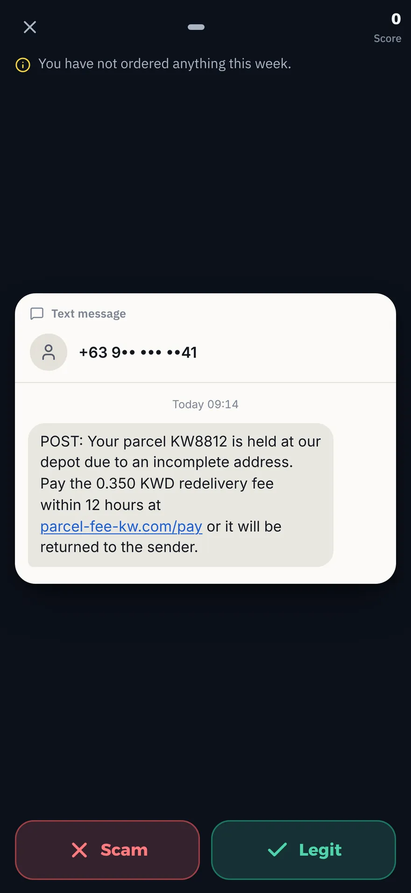
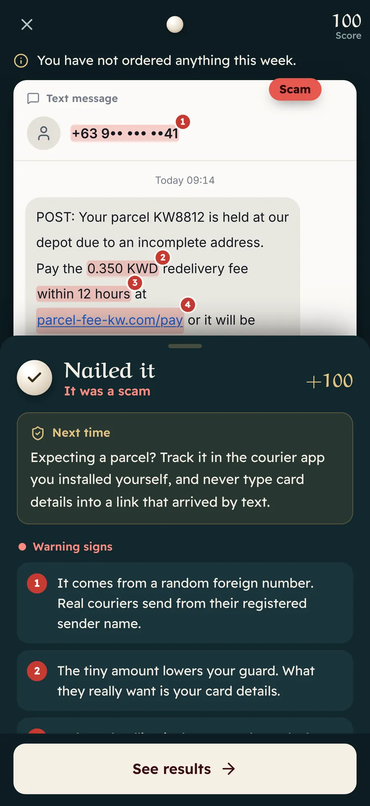
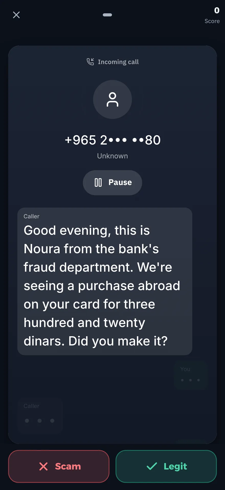
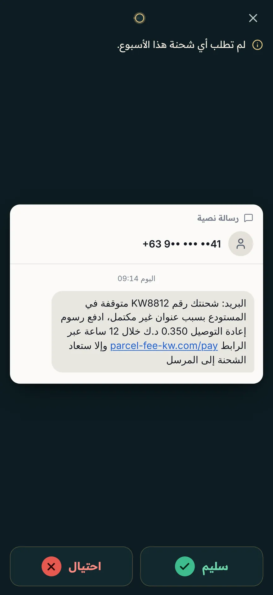
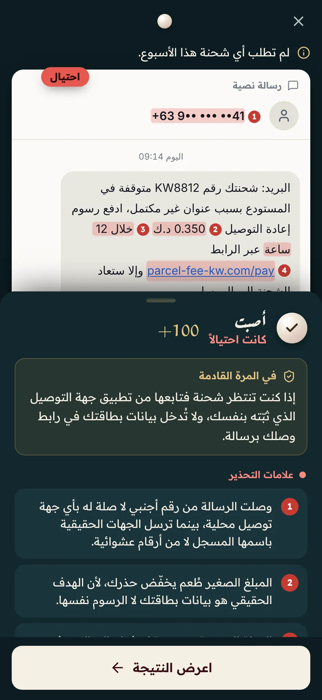
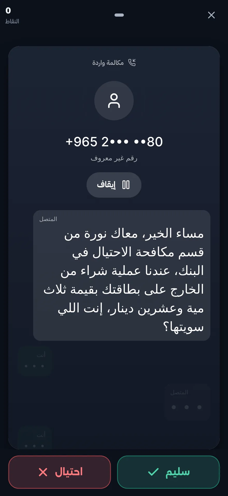

# Scam Detective

**Swipe left on scams.** A free swipe game that trains people to spot scams in texts, calls, emails, chats, web pages and QR codes, in Arabic and English.

**[Play in your browser](https://siteq8.github.io/scam-game/play/)** · [Website](https://siteq8.github.io/scam-game/) · [العربية](#arabic)

The full game plays in the browser today. The iPhone and Android apps are coming soon.

<table>
  <tr>
    <td></td>
    <td></td>
    <td></td>
  </tr>
  <tr>
    <td align="center">Swipe to judge</td>
    <td align="center">Every sign, marked</td>
    <td align="center">Calls you can hear</td>
  </tr>
</table>

## How it plays

Every card is a realistic message on a phone screen, in one of nine channels: a text message, an app notification, a chat, an email, a phone call, a web page, a QR code, a social post or a marketplace chat. Swipe left for scam and right for legit. The debrief then highlights the exact words that gave the message away and ends with a lesson for next time:

* **Warning signs**, in red, give a scam away.
* **Signs it is genuine**, in green, show what a real message looks like.
* **Traps**, in violet, feel reassuring but prove nothing: a padlock, a verified badge, a familiar sender name.

The game holds 112 cards, 66 scams and 46 genuine messages, with examples from the Arabian Gulf and from around the world. Every name, number and link on the cards is fictional: the links lead nowhere and the QR codes only say that they are a training example.

## Features

* **Daily case**: ten cards a day, the same for everyone on the same edition, from the easiest to the hardest, with a share grid that gives no answers away.
* **Journey**: eight chapters from first steps to expert. Get seven of ten right to open the next one.
* **60 second rush**: as many right calls as you can make before the clock runs out. A wrong call costs three seconds.
* **Flag hunt**: tap every warning sign on a scam before time runs out.
* **Play together**: one phone passed around the room. Each player judges their own cards and the game keeps the score.
* **Message checker**: paste a text, an email or a link you received and see the warning signs in it. The check runs on your device.
* **Stats**: accuracy by topic, a day streak, ranks and achievements, and *Practise what fooled you* to replay the cards you got wrong.
* **Voiced calls**: some cards ring. Answer and listen to the caller while the words appear on screen.
* **Two languages**: Arabic and English, with examples from the Gulf, from around the world, or both.
* **Accessibility**: larger text, reduced motion, light and dark themes, and a written transcript for every call.

## Privacy

No account, no ads, no tracking and no analytics. The app never connects to the internet: the built app carries a Content Security Policy that allows only the files bundled with it, and it asks for no access to contacts, location, camera, microphone, photos or notifications. Settings, scores and streaks stay on the device and can be erased from the settings. A message pasted into the checker is examined on the device and discarded when you leave the screen. The website sets no cookies and loads nothing from other sites. The full policy is on the [privacy page](https://siteq8.github.io/scam-game/privacy/).

## How it works

### From card to app

1. Cards are JSON files in `content/cards/`, written to the contract in [content/SCHEMA.md](content/SCHEMA.md). Each card has a complete Arabic block and a complete English block, each with the card itself, two to four signals and a lesson.
2. `scripts/validate-content.mjs` checks every card: the fields of each channel, signals that quote the card text exactly, the balance of warning and genuine signs, the punctuation rules in both languages, brand names, masked phone numbers, and that genuine cards show no address other than a government or example domain.
3. `scripts/build-content.mjs` merges the cards into `app/src/content/cards.json`, links every call and voice note to its recording and line timings in `app/public/audio/`, and draws the QR codes, which only say that they are a training example.
4. Vite builds the Preact app into `dist/`, and Capacitor copies that build into the Android and iOS projects.
5. `scripts/build-site.mjs` renders the website from `site/` into `docs/` in both languages, with a live message checker, and copies the game into `docs/play/`. GitHub Pages serves `docs/`.

### The checker engine

`app/src/engine/checker.ts` reads a message in English or Arabic and lists the warning signs it finds. It never says that a message is safe.

* **Text**: pressure and deadlines, threats, requests for payment, codes or passwords, prizes, returns that sound too good, moving the talk somewhere private, payments that cannot be recovered, app installs, a new number for someone you know, generic greetings and requests to verify details. Arabic matching ignores common spelling variants, harakat and tatweel.
* **Links**: shortened links, addresses made of numbers, look-alike letters, "gov" used as a word inside an address, addresses stuffed with words and hyphens, endings common in scam links, plain http, and trust words such as secure or verify inside the address. Real government domains are recognised.
* **Numbers**: an international number, when Gulf numbers count as local.

Each finding has a weight, and the total sets the level: strong signs of a scam, be careful, or nothing obvious but still verify. A code message that warns you not to share the code and carries no link is treated as a likely genuine code message, not as a request for secrets. The same engine runs in the app and in the live checker on the website, and the tests run it on every card: each scam must raise at least a warning, and no genuine card may be rated a strong scam.

### The daily case

`app/src/engine/daily.ts` numbers the cases from Case #1 on 16 October 2026, one per local calendar day. Each day's ten cards come from a shuffle seeded with the day and the edition, so every device picks the same cards without a server. Cards are drawn in cycles through the whole pool, so the same card does not keep coming back. The ten are then balanced, with at least three genuine cards, at least four scams and no more than two from one channel, and sorted from easiest to hardest. The Gulf edition draws from every card and the Global edition from the global ones; players who choose worldwide examples get the Global edition. The share grid is one green or red square per card.

## Develop

You need Node 22, the version CI uses.

```bash
git clone https://github.com/SiteQ8/scam-game.git
```

Then, inside the clone:

```bash
npm ci
npm run dev
```

| Command | What it does |
|---|---|
| `npm run dev` | Starts the Vite dev server on port 5173, open to other devices on your network. The Content Security Policy is added to builds only. |
| `npm run content` | Validates the cards, then rebuilds `app/src/content/cards.json`. |
| `npm run build` | Runs `content`, then builds the app into `dist/`. |
| `npm run build:site` | Runs `build`, then renders the website and the browser game into `docs/`. |
| `npm test` | Runs the Vitest suites in `tests/`: the checker, the content, the daily case and the language rules. |
| `npm run check` | Type checks the app, the site code and the tests with TypeScript. |
| `npm run brand` | Writes the names, the web address and the app ID from `brand.json` into the iPhone and Android projects, the repository documents and the store listings. `node scripts/apply-brand.mjs --check` lists what is still missing. |

`brand.json` holds the names in both languages, the web address, the app ID and the repository; the app, the site build and the release workflows read it. To publish the site, point GitHub Pages at the `docs` folder of the `main` branch. When `brand.json` has a domain, the site build also writes `docs/CNAME` and a sitemap.

### Android

You need JDK 21 and the Android SDK, which comes with Android Studio.

```bash
npm run build
npx cap sync android
npx cap open android
```

To build a debug APK from the command line instead:

```bash
cd android
./gradlew assembleDebug
```

The APK lands in `android/app/build/outputs/apk/debug/`.

### iOS

You need a Mac with Xcode.

```bash
npm run build
npx cap sync ios
npx cap open ios
```

Capacitor and its plugins come in through Swift Package Manager (`ios/App/CapApp-SPM`), so there is no CocoaPods step. Run `npx cap sync` after every web build so both native projects get the new files.

### Tools

* `tools/marketing/capture.mjs` captures real screens of the game from a capture build (`npx vite build --mode capture`), and `tools/marketing/site-images.py` turns them into the website's pictures in `site/img/`.
* `tools/marketing/og.mjs` draws the link preview images from those screens.
* `tools/render-icons.mjs` renders the app icons, splash images and web icons from `art/icon.svg`.
* `scripts/build-fonts.mjs` and `scripts/build-icons.mjs` copy the font files and the Lucide icons the app uses out of their packages.
* `tools/voice_plan.mjs`, `tools/voice_pick.py`, `tools/voice_post.py` and the `tools/audio_*.py` scripts plan the call voices, pick the best takes and give them the sound of a phone line, with line timings.

These tools need Playwright, sharp or ffmpeg, and some set machine specific paths at the top of the file; adjust them before you run them.

### Continuous integration and releases

* **`ci.yml`** runs on every push to `main` and every pull request. It installs with `npm ci` on Node 22, validates the cards, type checks, runs the tests, builds the game and the site, and fails if `docs/` differs from the build. On pushes it also compiles the iOS app for the simulator without signing. It needs no secrets.
* **`android.yml`** runs on pushes to `main` that touch the app, the cards or `android/`, on tags that start with `android-v`, and by hand. It builds a debug APK and keeps it as a workflow artifact. On a tag such as `android-v1.0.0`, with the keystore secrets set, it also builds a signed release bundle (AAB); with `PLAY_SERVICE_ACCOUNT` set too, it uploads the bundle to the internal testing track on Google Play, as a draft until the app has been sent for review, with release notes from `store/google-play/<language>/changelogs/default.txt` when that file exists.
* **`ios.yml`** runs on tags that start with `ios-v`, and by hand. It builds a signed release archive, packages the IPA, validates it and uploads it to App Store Connect, and keeps the IPA as a workflow artifact. The build number is the workflow run number. It stops with a message when the signing secrets are missing.

To start a release, push a tag:

```bash
git tag android-v1.0.0 && git push origin android-v1.0.0
git tag ios-v1.0.0 && git push origin ios-v1.0.0
```

Add the secrets in the repository settings, under Secrets and variables, Actions:

| Secret | Workflow | Value |
|---|---|---|
| `ANDROID_KEYSTORE_BASE64` | android | The upload keystore, base64 encoded |
| `ANDROID_KEYSTORE_PASSWORD` | android | The keystore password |
| `ANDROID_KEY_ALIAS` | android | The key alias |
| `ANDROID_KEY_PASSWORD` | android | The key password |
| `PLAY_SERVICE_ACCOUNT` | android | The JSON key of a Google Play service account with access to the app |
| `IOS_TEAM_ID` | ios | The Apple Developer team ID |
| `IOS_CERT_P12` | ios | The Apple Distribution certificate with its private key, as a .p12 file, base64 encoded |
| `IOS_CERT_PASSWORD` | ios | The password of that .p12 file |
| `IOS_PROFILE` | ios | An App Store provisioning profile for the app ID in `brand.json`, base64 encoded |
| `ASC_KEY_ID` | ios | The App Store Connect API key ID |
| `ASC_ISSUER_ID` | ios | The App Store Connect API issuer ID |
| `ASC_KEY_P8` | ios | The App Store Connect API private key: the text of the .p8 file, not base64 |

## Repository layout

| Path | Contents |
|---|---|
| `app/` | The game: Preact with @preact/signals, built by Vite. `src/engine/` holds the checker, the daily case, the decks and the scoring; `src/i18n/strings.ts` holds every interface string in both languages. |
| `content/` | The cards in `content/cards/` and their contract in `content/SCHEMA.md`. |
| `scripts/` | Card validation and build, font and icon extraction, and the site build. |
| `site/` | The website source: the copy in both languages, the page templates, the styles and the screenshots. |
| `docs/` | The built website served by GitHub Pages, with the game in `docs/play/`. Generated, so do not edit it by hand. |
| `android/`, `ios/` | The Capacitor projects. |
| `store/` | The App Store and Google Play listings in both languages, with their screenshots, graphics, trailer and release notes. |
| `tests/` | The Vitest suites. |
| `tools/` | Audio, icon and screenshot tools. |
| `art/`, `assets/` | The icon source, and the icon and splash images made from it. |
| `brand.json` | The names, web address, app ID and repository. |

## Suggest a card

Did a message fool you or someone you know? Send it to [site@hotmail.com](mailto:site@hotmail.com?subject=A%20message%20that%20fooled%20someone) with names, numbers and links removed. If it teaches something new, it may become a card. To write the card yourself, open a pull request: [CONTRIBUTING.md](CONTRIBUTING.md) explains the card format and the rules every card must pass.

Please report security issues privately, as [SECURITY.md](SECURITY.md) describes.

## Credits

* Made by Ali AlEnezi, Kuwait.
* Call voices, music and sound effects generated with ElevenLabs.
* Fonts: Alexandria and IBM Plex Sans Arabic, under the SIL Open Font License 1.1.
* Icons: Lucide, under the ISC License.
* Built with Preact, @preact/signals, Vite and Capacitor.

## License

MIT, © 2026 Ali AlEnezi. See [LICENSE](LICENSE). The fonts, icons and libraries keep their own licenses, listed with their copyright lines in [THIRD_PARTY_NOTICES.md](THIRD_PARTY_NOTICES.md).

<div dir="rtl" lang="ar">

# <a name="arabic"></a>محقق الاحتيال

**اكشف الاحتيال بسحبة**، لعبة سحب مجانية تدرّب الناس على كشف الاحتيال في الرسائل والمكالمات والبريد والمحادثات والصفحات ورموز QR، بالعربية والإنجليزية.

**[العب الآن في متصفحك](https://siteq8.github.io/scam-game/play/?lang=ar)** · [الموقع](https://siteq8.github.io/scam-game/ar/)

تعمل اللعبة كاملة في المتصفح اليوم، وتطبيقا آيفون وأندرويد قريباً.

<table>
  <tr>
    <td></td>
    <td></td>
    <td></td>
  </tr>
  <tr>
    <td align="center">اسحب لتحكم</td>
    <td align="center">كل علامة واضحة</td>
    <td align="center">مكالمات تسمعها</td>
  </tr>
</table>

## طريقة اللعب

كل بطاقة رسالة تحاكي ما يظهر على شاشة الهاتف، فتسحبها يساراً إن رأيتها احتيالاً ويميناً إن رأيتها سليمة، ثمّ يظلل الشرح الكلمات التي كشفتها ويقدم لك درساً للمرة القادمة.

تأتي البطاقات من تسع قنوات هي الرسائل النصية وإشعارات التطبيقات والمحادثات والبريد الإلكتروني والمكالمات وصفحات الويب ورموز QR ومنشورات التواصل الاجتماعي ومحادثات البيع والشراء.

ويفرّق الشرح بين ثلاثة أنواع من العلامات:

* **علامات التحذير** بالأحمر، وهي ما يكشف الاحتيال.
* **علامات الثقة** بالأخضر، وهي ما يميز الرسالة السليمة.
* **الفخاخ** بالبنفسجي، أي التفاصيل التي تطمئنك ولا تثبت شيئاً مثل القفل في شريط العنوان أو علامة التوثيق أو اسم مرسل مألوف.

تضم اللعبة 112 بطاقة، منها 66 بطاقة احتيال و46 بطاقة سليمة، بأمثلة من الخليج العربي ومن حول العالم.

كل الأسماء والأرقام والروابط في البطاقات وهمية، فالروابط لا تقود إلى أي مكان ورموز QR لا تحمل إلا عبارة تقول إنها مثال للتدريب.

## المزايا

* **ملف اليوم**: عشر بطاقات جديدة كل يوم يلعبها الجميع في النسخة نفسها، مرتبة من الأسهل إلى الأصعب، ومعها شبكة نتيجة تشاركها دون أن تكشف الإجابات.
* **المسار**: ثمانية فصول تبدأ بالخطوات الأولى وتنتهي بمستوى الخبراء، وتفتح الفصل التالي حين تصيب في سبع بطاقات من عشر.
* **سباق الستين ثانية**: أكبر عدد من الأحكام الصحيحة قبل نفاد الوقت، وكل حكم خاطئ يخصم ثلاث ثوانٍ.
* **صيد العلامات**: تلمس كل علامة تحذير في بطاقة الاحتيال قبل أن ينفد الوقت.
* **تحدٍّ جماعي**: هاتف واحد يتنقل بين اللاعبين، فيحكم كل لاعب على بطاقاته وتحسب اللعبة النقاط.
* **أداة الفحص**: تلصق رسالة أو بريداً أو رابطاً وصلك فتعرف علامات التحذير فيه، والفحص يجري على جهازك.
* **الإحصاءات**: دقتك في كل موضوع وسلسلة أيامك ورتبتك وإنجازاتك، مع خيار «تدرّب على ما خدعك» لتعيد البطاقات التي أخطأت فيها.
* **مكالمات تسمعها**: بعض البطاقات ترن، فترد وتستمع إلى المتصل بينما تظهر كلماته على الشاشة.
* **لغتان**: العربية والإنجليزية، وتختار من الإعدادات أمثلة من الخليج أو من حول العالم أو من الاثنين معاً.
* **سهولة الاستخدام**: نص أكبر وتقليل للحركة ومظهران فاتح وداكن ونص مكتوب لكل مكالمة.

## الخصوصية

لا حساب ولا إعلانات ولا تتبع ولا أدوات تحليل، والتطبيق لا يتصل بالإنترنت أبداً لأنّ نسخته المبنية تحمل سياسة أمان محتوى لا تسمح إلا بالملفات المضمنة فيها.

لا يطلب التطبيق الوصول إلى جهات الاتصال ولا الموقع ولا الكاميرا ولا الميكروفون ولا الصور ولا الإشعارات، ويستخدم الاهتزاز للتنبيه اللمسي وتستطيع إيقافه من الإعدادات.

تُحفظ إعداداتك ونقاطك وسلاسلك وإنجازاتك على جهازك لتكمل من حيث توقفت، ولا تغادره أبداً، وتستطيع أن تمسحها متى شئت عبر خيار «امسح تقدمي» في الإعدادات أو بحذف التطبيق.

الرسالة التي تلصقها في أداة الفحص تُفحص على جهازك وتُهمل حين تغادر الشاشة، فلا تُحفظ ولا تُرسل إلى أي مكان.

ولا يضع الموقع ملفات تعريف ارتباط ولا يحمّل نصوصاً برمجية أو خطوطاً من أي جهة أخرى، وتجد السياسة كاملة في [صفحة الخصوصية](https://siteq8.github.io/scam-game/ar/privacy/).

## كيف تعمل اللعبة

### من البطاقة إلى التطبيق

1. تُكتب البطاقات بصيغة JSON في المجلد `content/cards` وفق المواصفات في [content/SCHEMA.md](content/SCHEMA.md)، ولكل بطاقة نص عربي كامل وآخر إنجليزي، مع علاماتها ودرسها في كل لغة.
2. يفحص `scripts/validate-content.mjs` كل بطاقة، فيتحقق من حقول كل قناة ومن أن كل علامة منقولة حرفياً من نص البطاقة ومن توازن علامات التحذير والثقة، ويرفض الشرطات والنقطة في منتصف الجملة العربية وأسماء العلامات التجارية الحقيقية وأرقام الهواتف الظاهرة كاملة.
3. يدمج `scripts/build-content.mjs` البطاقات في الملف `app/src/content/cards.json`، ويربط كل مكالمة ورسالة صوتية بتسجيلها وتوقيت سطورها، ويرسم رموز QR التي لا تحمل إلا عبارة تقول إنها مثال للتدريب.
4. يبني Vite التطبيق في المجلد `dist`، ثمّ ينسخه Capacitor إلى مشروعي أندرويد وآيفون.
5. يبني `scripts/build-site.mjs` الموقع باللغتين من المجلد `site` في المجلد `docs` مع أداة فحص حية، وينسخ اللعبة إلى `docs/play` لتُلعب في المتصفح، ثمّ تنشر خدمة GitHub Pages محتوى المجلد `docs`.

### أداة الفحص

يقرأ المحرك في `app/src/engine/checker.ts` الرسالة بالعربية أو الإنجليزية ويعدد علامات التحذير التي يجدها، لكنه لا يحكم أبداً بأن الرسالة آمنة.

* **في النص**: الاستعجال والتهديد وطلب الدفع وطلب الرموز وكلمات المرور والجوائز والأرباح التي تبدو أجمل من الحقيقة ونقل الحديث بعيداً عن الأعين وطرق الدفع التي لا تُسترجع وطلب تثبيت تطبيق والرقم الجديد لشخص تعرفه والتحية العامة وطلب تأكيد البيانات.
* **في العربية**: تتجاوز المطابقة اختلاف الإملاء في الهمزات والتاء المربوطة والألف المقصورة، وتتجاهل التشكيل والتطويل.
* **في الروابط**: الروابط المختصرة والعناوين المكونة من أرقام والحروف المقلدة من أبجديات أخرى وكلمة gov حين تأتي داخل العنوان لا في نهايته والعناوين المحشوة بالكلمات والشرطات والنهايات الشائعة في روابط الاحتيال والبادئة http وكلمات الثقة مثل secure و verify داخل العنوان، بينما يتعرف المحرك على النطاقات الحكومية الحقيقية.
* **في الأرقام**: الرقم الدولي حين تُعامل أرقام الخليج على أنها محلية.

تحمل كل علامة وزناً، ويحدد مجموع الأوزان مستوى النتيجة بين «علامات قوية على الاحتيال» و«تعامل معها بحذر» و«لا شيء واضح، وتحقق مع ذلك».

وإذا جاءت رسالة فيها رمز وتحذير من مشاركته ولا رابط فيها عدّها المحرك رسالة رمز تحقق حقيقية على الأرجح، لا طلباً للبيانات السرية.

ويعمل المحرك نفسه في التطبيق وفي أداة الفحص على الموقع، وتشغّله الاختبارات على كل بطاقات اللعبة لتتأكد من أن كل بطاقة احتيال تثير تحذيراً على الأقل ومن أن أي بطاقة سليمة لا تُصنف احتيالاً قوياً.

### ملف اليوم

يرقّم `app/src/engine/daily.ts` الملفات بدءاً من الملف رقم 1 في 16 أكتوبر 2026، ويعطي كل يوم بعده الرقم التالي حسب التقويم المحلي للجهاز.

تُختار البطاقات العشر بخلط عشوائي يُحسب من اليوم والنسخة، لذا يحصل كل من يلعب النسخة نفسها على البطاقات نفسها في اليوم نفسه دون أي خادم.

وتمر اللعبة على البطاقات كلها في دورات حتى لا تعود البطاقة نفسها مرة بعد مرة.

وبعد الاختيار تضبط اللعبة المجموعة لتضم ثلاث بطاقات سليمة على الأقل وأربع بطاقات احتيال على الأقل ولا تزيد بطاقات القناة الواحدة على اثنتين، وترتبها من الأسهل إلى الأصعب.

تشمل نسخة الخليج كل البطاقات، بينما تقتصر النسخة العالمية على الأمثلة العالمية ويلعبها من يختار أمثلة «حول العالم» في الإعدادات.

أما شبكة النتيجة فمربع أخضر أو أحمر لكل بطاقة، لذا تشاركها دون أن تكشف أي إجابة.

## التطوير والبناء

تحتاج إلى Node 22، وهو الإصدار الذي يستخدمه التكامل المستمر.

<div dir="ltr">

```bash
git clone https://github.com/SiteQ8/scam-game.git
```

</div>

ثمّ نفّذ داخل المجلد:

<div dir="ltr">

```bash
npm ci
npm run dev
```

</div>

| الأمر | ما يفعله |
|---|---|
| `npm run dev` | يشغّل خادم Vite للتطوير على المنفذ 5173 ويصل إليه أي جهاز في شبكتك، ولا تُضاف سياسة أمان المحتوى إلا إلى النسخ المبنية |
| `npm run content` | يفحص البطاقات فيبني الملف `app/src/content/cards.json` |
| `npm run build` | يشغّل `content` فيبني التطبيق في المجلد `dist` |
| `npm run build:site` | يشغّل `build` فيبني الموقع ونسخة المتصفح من اللعبة في المجلد `docs` |
| `npm test` | يشغّل اختبارات Vitest في المجلد `tests` للمحرك والمحتوى وملف اليوم وقواعد اللغة |
| `npm run check` | يفحص الأنواع في التطبيق وشيفرة الموقع والاختبارات عبر TypeScript |
| `npm run brand` | يكتب الاسمين والعنوان ومعرّف التطبيق من `brand.json` في مشروعي آيفون وأندرويد ووثائق المستودع وصفحات المتاجر، ويعرض الأمر `node scripts/apply-brand.mjs --check` ما لم يكتمل بعد |

يحمل الملف `brand.json` اسمي اللعبة بالعربية والإنجليزية وعنوانها على الويب ومعرّف التطبيق والمستودع، ويقرؤه التطبيق وبناء الموقع وسير عمل الإصدارات.

ولنشر الموقع اضبط GitHub Pages على المجلد `docs` في الفرع `main`، وإذا حمل `brand.json` نطاقاً كتب بناء الموقع الملف `docs/CNAME` وخريطة الموقع أيضاً.

### أندرويد

تحتاج إلى JDK 21 و Android SDK الذي يأتي مع Android Studio.

<div dir="ltr">

```bash
npm run build
npx cap sync android
npx cap open android
```

</div>

ولتبني نسخة APK للتجربة من سطر الأوامر نفّذ:

<div dir="ltr">

```bash
cd android
./gradlew assembleDebug
```

</div>

وستجد الملف في `android/app/build/outputs/apk/debug`.

### آيفون

تحتاج إلى جهاز Mac عليه Xcode.

<div dir="ltr">

```bash
npm run build
npx cap sync ios
npx cap open ios
```

</div>

يصل Capacitor وإضافاته عبر Swift Package Manager في المجلد `ios/App/CapApp-SPM`، لذا لا حاجة إلى CocoaPods، وبعد كل بناء للويب شغّل `npx cap sync` لتصل الملفات الجديدة إلى المشروعين.

### الأدوات

* يلتقط `tools/marketing/capture.mjs` شاشات حقيقية من نسخة خاصة بالتصوير تبنيها بالأمر `npx vite build --mode capture`، ثمّ يحوّلها `tools/marketing/site-images.py` إلى صور الموقع في المجلد `site/img`.
* يرسم `tools/marketing/og.mjs` صور معاينة الروابط من تلك الشاشات.
* يرسم `tools/render-icons.mjs` أيقونات التطبيق وصور شاشة البداية وأيقونات الويب من `art/icon.svg`.
* ينسخ `scripts/build-fonts.mjs` و `scripts/build-icons.mjs` ملفات الخطوط وأيقونات Lucide التي يستخدمها التطبيق من حزمها.
* تخطط أدوات الصوت في المجلد `tools` لأصوات المكالمات وتختار أفضل التسجيلات ثمّ تمنحها صوت خط الهاتف وتوقيت السطور.

وتحتاج هذه الأدوات إلى Playwright أو sharp أو ffmpeg، وفي أعلى بعضها مسارات خاصة بجهاز معين فعدّلها قبل التشغيل.

### التكامل المستمر والإصدارات

**`ci.yml`**: يعمل مع كل دفع إلى الفرع `main` ومع كل طلب دمج، فيثبت الحزم على Node 22 ويفحص البطاقات والأنواع ويشغّل الاختبارات ويبني اللعبة والموقع ويتأكد من أن المجلد `docs` يطابق نتيجة البناء، ومع كل دفع يبني تطبيق آيفون للمحاكي دون توقيع، ولا يحتاج إلى أي أسرار.

**`android.yml`**: يعمل مع كل دفع إلى `main` يمس التطبيق أو البطاقات أو المجلد `android`، ومع الوسوم التي تبدأ بـ `android-v`، أو يدوياً، فيبني نسخة APK للتجربة ويحفظها في نتائج سير العمل.

وعند دفع وسم مثل `android-v1.0.0` مع أسرار مخزن المفاتيح يبني حزمة إصدار موقّعة بصيغة AAB، وإذا وُجد السر `PLAY_SERVICE_ACCOUNT` أيضاً رفعها إلى مسار الاختبار الداخلي في Google Play في صورة مسودة إلى أن يُرسل التطبيق للمراجعة أول مرة، مع ملاحظات الإصدار من الملف `store/google-play/<language>/changelogs/default.txt` إن وُجد.

**`ios.yml`**: يعمل مع الوسوم التي تبدأ بـ `ios-v` أو يدوياً، فيبني أرشيف إصدار موقّعاً ويحزم ملف IPA ثمّ يتحقق منه ويرفعه إلى App Store Connect ويحفظه في نتائج سير العمل، ورقم البناء فيه هو رقم تشغيل سير العمل، وإذا غابت أسرار التوقيع توقف برسالة تذكر الأسرار المطلوبة.

ولتبدأ إصداراً ادفع وسماً:

<div dir="ltr">

```bash
git tag android-v1.0.0 && git push origin android-v1.0.0
git tag ios-v1.0.0 && git push origin ios-v1.0.0
```

</div>

وأضف الأسرار في إعدادات المستودع من صفحة Actions ضمن Secrets and variables:

| السر | سير العمل | محتواه |
|---|---|---|
| `ANDROID_KEYSTORE_BASE64` | android | مخزن مفاتيح الرفع بترميز base64 |
| `ANDROID_KEYSTORE_PASSWORD` | android | كلمة مرور المخزن |
| `ANDROID_KEY_ALIAS` | android | الاسم المستعار للمفتاح |
| `ANDROID_KEY_PASSWORD` | android | كلمة مرور المفتاح |
| `PLAY_SERVICE_ACCOUNT` | android | مفتاح JSON لحساب خدمة في Google Play له صلاحية على التطبيق |
| `IOS_TEAM_ID` | ios | معرّف فريق المطور لدى Apple |
| `IOS_CERT_P12` | ios | شهادة Apple Distribution مع مفتاحها الخاص في ملف p12 بترميز base64 |
| `IOS_CERT_PASSWORD` | ios | كلمة مرور ملف p12 |
| `IOS_PROFILE` | ios | ملف توفير للتوزيع عبر App Store لمعرّف التطبيق في `brand.json` بترميز base64 |
| `ASC_KEY_ID` | ios | معرّف مفتاح App Store Connect API |
| `ASC_ISSUER_ID` | ios | معرّف الجهة المصدرة لمفتاح App Store Connect API |
| `ASC_KEY_P8` | ios | المفتاح الخاص لواجهة App Store Connect API، أي نص ملف p8 كما هو دون base64 |

## بنية المستودع

| المسار | محتواه |
|---|---|
| `app` | اللعبة نفسها، مبنية بـ Preact و Preact Signals و Vite، وفي `app/src/engine` محرك الفحص وملف اليوم ومجموعات البطاقات والنقاط، وفي `app/src/i18n/strings.ts` كل نصوص الواجهة باللغتين |
| `content` | البطاقات في `content/cards` ومواصفاتها في `content/SCHEMA.md` |
| `scripts` | فحص البطاقات وبناؤها واستخراج الخطوط والأيقونات وبناء الموقع |
| `site` | مصدر الموقع، أي نصوصه باللغتين وقوالب صفحاته وتنسيقه ولقطات الشاشة |
| `docs` | الموقع المبني الذي تنشره GitHub Pages مع اللعبة في `docs/play`، وهو مولّد لذا لا تعدّله يدوياً |
| `android` و `ios` | مشروعا Capacitor |
| `store` | بيانات المتجرين باللغتين مع لقطات الشاشة والرسوم والمقطع الترويجي وملاحظات الإصدار |
| `tests` | اختبارات Vitest |
| `tools` | أدوات الصوت والأيقونات ولقطات الشاشة |
| `art` و `assets` | مصدر الأيقونة، وصور الأيقونة وشاشة البداية المولّدة منه |
| `brand.json` | الاسمان وعنوان الويب ومعرّف التطبيق والمستودع |

## اقترح بطاقة

إن خدعتك رسالة أو خدعت شخصاً تعرفه فأرسلها إلى [site@hotmail.com](mailto:site@hotmail.com) بعد أن تحذف منها الأسماء والأرقام والروابط، فإن كانت تعلّم شيئاً جديداً فقد تصبح بطاقة في اللعبة.

ولتكتب البطاقة بنفسك افتح طلب دمج، وستجد في [CONTRIBUTING.md](CONTRIBUTING.md) صيغة البطاقة والقواعد التي يجب أن تجتازها.

وإن وجدت ثغرة أمنية فأبلغ عنها بسرية كما يشرح [SECURITY.md](SECURITY.md).

## الشكر والمصادر

* صنع اللعبة علي العنزي من الكويت.
* صُنعت أصوات المكالمات والموسيقى والمؤثرات الصوتية عبر ElevenLabs.
* الخطوط Alexandria و IBM Plex Sans Arabic برخصة SIL Open Font License 1.1.
* الأيقونات من Lucide برخصة ISC.
* تعتمد اللعبة على Preact و Preact Signals و Vite و Capacitor.

## الرخصة

المشروع مرخص برخصة MIT، © 2026 علي العنزي، والنص الكامل في [LICENSE](LICENSE)، بينما تحتفظ الخطوط والأيقونات والمكتبات برخصها المذكورة مع عبارات حقوقها في [THIRD_PARTY_NOTICES.md](THIRD_PARTY_NOTICES.md).

</div>
